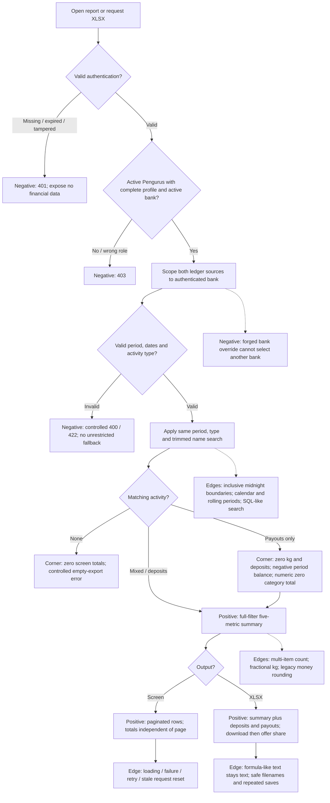

# PIL-248 delivery and review evidence

The feature adds five full-filter operational metrics and a combined deposit/payout XLSX export. The screen and export use the same period/type/search selection and authenticated bank. Period balance means deposit movement minus gross payout movement, not live balance.

### Explicit RED → GREEN → REFACTOR history

| Cycle | RED | GREEN | REFACTOR | What changed |
|---|---|---|---|---|
| Backend summary/export | [900e60a](https://github.com/bank-sampah-PILAH/pilah-be/commit/900e60a) | [97c0eae](https://github.com/bank-sampah-PILAH/pilah-be/commit/97c0eae) | [1192e11](https://github.com/bank-sampah-PILAH/pilah-be/commit/1192e11) | Missing summary/third sheet, ignored type filter, unsafe spreadsheet text and absent privacy headers → scoped totals and combined XLSX → DRY shared ledger source queries/public port and streamed monetary values. |
| Backend payout-only corner | [d2b4b43](https://github.com/bank-sampah-PILAH/pilah-be/commit/d2b4b43) | [3f568d7](https://github.com/bank-sampah-PILAH/pilah-be/commit/3f568d7) | [a5a6bc8](https://github.com/bank-sampah-PILAH/pilah-be/commit/a5a6bc8) | Expose circular =SUM(E2:E1) on payout-only workbook → numeric zero → extract summary-sheet presentation (SRP). |
| Backend period metadata | [396f208](https://github.com/bank-sampah-PILAH/pilah-be/commit/396f208) | [5c5e188](https://github.com/bank-sampah-PILAH/pilah-be/commit/5c5e188) | [312478f](https://github.com/bank-sampah-PILAH/pilah-be/commit/312478f) | Rolling/default labels disagree with filters → correct metadata → explicit period default at formatter boundary (SRP). |
| Frontend summary/export | [3d28b38](https://github.com/bank-sampah-PILAH/pilah-mobile/commit/3d28b38) | [e0ad5b6](https://github.com/bank-sampah-PILAH/pilah-mobile/commit/e0ad5b6) | [d5e7bee](https://github.com/bank-sampah-PILAH/pilah-mobile/commit/d5e7bee) | Specify response/state/filter contracts → render five metrics and filtered export → centralize summary validation and metric layout (DRY/SRP). |
| Frontend browser save/share | [427523c](https://github.com/bank-sampah-PILAH/pilah-mobile/commit/427523c) | [d62a831](https://github.com/bank-sampah-PILAH/pilah-mobile/commit/d62a831) | [be5460b](https://github.com/bank-sampah-PILAH/pilah-mobile/commit/be5460b) | Record real HTTP-200-but-no-download browser failure → conditional browser Blob/native file saving and byte sharing → share MIME/attachment policy (DRY/platform separation). |

RED commits precede implementation; the browser RED records an observed release-browser failure, not a fabricated unit-test result. GREEN supplies the smallest behavior fix; REFACTOR preserves the tests while consolidating responsibilities. Existing commit history is preserved; no relabeling, squash or amended TDD history. Later staging integration and screenshot documentation are delivery work, not retroactive TDD cycles.

### Five OWASP Top 10:2025 categories mitigated

Names follow the [official OWASP Top 10:2025 list](https://top10.owasp.org/2025/).
These are specific tested controls, not claims of complete category prevention or a security certification.

| Category | Implemented/reused control | Evidence |
|---|---|---|
| **A01 Broken Access Control** | Reuse active Pengurus permission gate; share authenticated-bank scoping across feed, totals and XLSX. Ignore a client-provided bank override. | [`IsActivePengelola`](https://github.com/bank-sampah-PILAH/pilah-be/blob/feature/pil-248/shared_kernel/permissions.py), [`activity_sources`](https://github.com/bank-sampah-PILAH/pilah-be/blob/feature/pil-248/apps/ledger/activity.py), tests `test_cross_bank_and_client_bank_override_do_not_leak`, `test_nasabah_superadmin_and_anonymous_are_denied`, `test_inactive_bank_and_incomplete_manager_are_denied`. |
| **A02 Security Misconfiguration** | Add `Cache-Control: private, no-store` and `X-Content-Type-Options: nosniff` to financial responses. | [`ActivityHistoryView` / `TransaksiViewSet.export`](https://github.com/bank-sampah-PILAH/pilah-be/blob/feature/pil-248/apps/ledger/views.py); `test_financial_responses_are_private_and_not_cacheable`. Deployment TLS/CORS is not certified by this control. |
| **A05 Injection** | Keep ORM parameterized name search; escape formula-like user text in XLSX. Trusted category formulas remain intentional. | [`_excel_text`](https://github.com/bank-sampah-PILAH/pilah-be/blob/feature/pil-248/apps/reporting/exporter.py); `test_formula_like_user_text_is_not_an_executable_excel_formula`, `test_sql_like_search_is_literal_and_not_a_filter_bypass`. |
| **A07 Authentication Failures** | Reuse existing JWT authentication; reject missing, expired and tampered tokens. No custom authentication is introduced. | `test_expired_and_tampered_tokens_are_denied` and anonymous assertions in [`test_operational_report.py`](https://github.com/bank-sampah-PILAH/pilah-be/blob/feature/pil-248/apps/reporting/test_operational_report.py). |
| **A10 Mishandling of Exceptional Conditions** | Reject invalid periods/types/dates, preserve controlled empty-export errors, handle payout-only reports; frontend rejects malformed summaries and displays loading/error/retry. | Backend invalid-filter/empty/payout-only tests and [`pil248_operational_report_test.dart`](https://github.com/bank-sampah-PILAH/pilah-mobile/blob/feature/pil-248/test/features/transaksi/pil248_operational_report_test.dart). |

The initial backend GREEN/refactor commit bodies explicitly record **A01/A02/A05/A07/A10**. Access/JWT gates are inherited protections covered by new regressions; private headers, Excel escaping and shared report behavior are feature work. Frontend controls complement server enforcement and do not replace it.

## Case flow

### Desktop and phone screenshots

**Phone screenshots are responsive web in Chrome, not native Android.** All images use synthetic local fixtures. The requested PNGs are included as review documentation so they render in this PR; build outputs, workbooks, logs and credentials are not committed.

Normal report — desktop and phone

| Desktop | Phone responsive web |
|---|---|
|  |  |

Loading — desktop and phone

| Desktop | Phone responsive web |
|---|---|
|  |  |

Empty result — desktop and phone

| Desktop | Phone responsive web |
|---|---|
|  |  |

Error state — desktop and phone

| Desktop | Phone responsive web |
|---|---|
|  |  |

Date-range dialog — desktop and phone

| Desktop | Phone responsive web |
|---|---|
|  |  |

Additional [filtered payout phone view](https://github.com/bank-sampah-PILAH/pilah-mobile/blob/feature/pil-248/docs/pil-248/screenshots/pengurus-filtered-mobile.png), [390px phone](https://github.com/bank-sampah-PILAH/pilah-mobile/blob/feature/pil-248/docs/pil-248/screenshots/pengurus-phone390.png), and [tablet](https://github.com/bank-sampah-PILAH/pilah-mobile/blob/feature/pil-248/docs/pil-248/screenshots/pengurus-tablet.png).

### Known limitations and review follow-ups

- **Android APK/native UI unvalidated:** the build reaches `:app:processDebugGoogleServices` and fails because authorized `google-services.json` is absent. No dummy config or bypass. The user's existing waiver permits this PR with the limitation stated. Responsive web captures do not verify native keyboard/insets/storage/share.
- Phone period chips can hide the active **Bulan Ini** selection offscreen. **1 Bulan** remains visible on larger viewports despite the earlier requested removal. These known UI issues are recorded, not silently claimed fixed by shipping.
- Inherited debug-only network logging prints complete bearer headers (synthetic probe confirmed); it is gated by `kDebugMode`. Public Downloads storage confidentiality/retention needs Android validation. No claim that these were introduced by PIL-248 or fully resolved.
- Whole-branch 100% coverage is not claimed. Prior VM-LCOV measured 114/115 changed executable lines; browser-only downloader/legacy helper were absent from VM LCOV. Browser behavior has separate real-browser evidence; exclusions/gate thresholds were not lowered.
- Browser share was replaced locally to inspect filename/MIME/bytes; matching SHA-256 confirms the same XLSX attachment. It does not verify an OS share recipient or native share sheet.
- CI/Sonar results must be read on these PR heads; prior staging metrics are not feature-head results. No merge or deployment is requested.

## Final staging integration validation

Staging design-system changes were integrated in `eeaf4b9`, retaining AppChip and the shared colors/type styles while preserving operational export. Before: summary cards duplicated literal color/font settings. After: AppColors.greenLight, AppTextStyle.small and AppTextStyle.headline3 own presentation choices (DRY/SRP). This is delivery integration, not a rewritten TDD cycle.

Dependency lockfile, formatting, analyzer and fresh web release build pass. Full Flutter suite: 2,002 pass, one existing skip, seven Windows-only source-scanning design-test failures. All seven reproduce on untouched staging fc4206e; they compare forward-slash paths with Windows backslashes. Tests and thresholds were not bypassed or weakened. Backend: 349 focused tests pass; full 641 has four independently reproduced baseline Windows deployment failure events; Ruff, strict mypy177, migrations and Django checks pass.

The screenshots in docs/pil-248/screenshots show the final integrated web build, with a browser-only API configuration override to the synthetic localhost backend. They do not prove native Android behavior. Browser checks confirm download HTTP 200 and identical downloaded/shared XLSX SHA-256. Only requested synthetic screenshots and this review documentation are committed; APKs, workbooks, logs and credentials remain outside Git.
