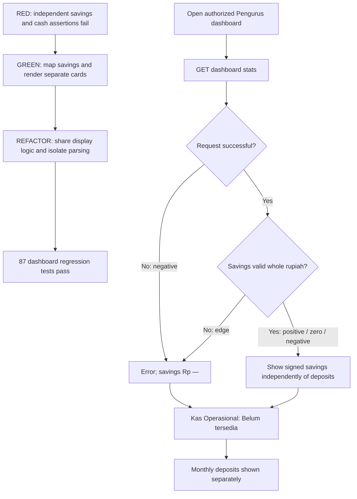

# Dashboard balance separation

The Pengurus dashboard now separates **Saldo Tabungan Nasabah**, **Kas
Operasional**, and **Nilai Setoran Bulan Ini**. Previously the monthly deposit
aggregate was presented as "Total Kas Bulan Ini", which could be mistaken for
cash available to spend.

Customer savings come from the backend's current `total_saldo_nasabah` aggregate.
Monthly deposits retain the existing `total_nilai_bulan_ini` field. Operational
cash always displays **Belum tersedia**: no operational cash ledger, balance
endpoint or input form exists in this delivery. Unknown cash does not mean zero.

## Access and input

1. Sign in with an authorized **Pengurus** account (internal role `pengelola`)
   belonging to a bank sampah unit.
2. Open **Dashboard**, route `/dashboard`, in the native application or the
   supported Pengurus web application. The page fetches
   `GET /api/v1/dashboard/stats` when opened; pull to refresh fetches it again.
3. Read the current customer savings, operational cash availability and monthly
   deposits as separate figures. The backend scopes the figures to the
   authenticated user's bank; changing a frontend value does not change that
   authorization.

There is **no place to input Kas Operasional** yet. Do not enter operational
cash as customer savings, a customer deposit or a withdrawal: those are separate
financial concepts. A future cash-ledger feature needs authorized cash-in/out
entries, opening balance, bank ownership, server validation, transaction/audit
history and a computed balance before real operational amounts can appear.

The positive (`Rp 2.500.000`) and zero (`Rp 0`) cash screenshots are explicitly
demo-only illustrations in `tool/dashboard_balance_preview.dart`. They are not
production states and do not persist any data. To reproduce locally:

```sh
flutter build web --release -t tool/dashboard_balance_preview.dart
python -m http.server 7357 --bind 127.0.0.1 --directory build/web
```

Open `http://127.0.0.1:7357/?cash=positive`, `?cash=zero`, or `/` for the actual
unavailable-cash component state. The preview uses invented customer savings of
`Rp 9.876.543` and deposits of `Rp 1.234.567`, with no authentication or network.
Do not deploy the preview as the application entrypoint.

## TDD: red, green and refactor

### Explicit reconstructed commits

At the user's request, the original change was reconstructed into three
separate commits from the original staging baseline, with each phase rerun.
These are newly verified reconstructed commits, not the original development
history. The original published head is retained at
`codex/dashboard-balance-before-tdd`.

- **Red** `6f78bb28`: the four savings/cash widget cases fail against the
  original dashboard, including independent values and narrow-phone cases.
- **Green** `50c3b542`: implement the separate balance cards and savings contract;
  all 87 dashboard tests pass. Display rules initially live in each widget.
- **Refactor** (this commit): extract those identical rules into
  `dashboard_balance_display.dart`, reuse the existing currency formatter and
  add the implementation/security evidence. All 87 tests still pass. The final
  application/test/preview source matches the previous PR head exactly.

The following notes describe the earlier implementation execution evidence.

**Red.** The new widget contract asserted separate savings/cash/deposit labels
and values. It failed against the original KPI implementation, which had only
the monthly cash label. The recorded red result is one failing widget test in
the workspace evidence `reports/dashboard-balances-red-flutter.txt`.

**Green.** Added nullable `totalSaldoNasabah` through remote datasource, entity,
cubit and state; bound both layouts to the new backend field; renamed the
monthly KPI and displayed unavailable operational cash. The first dashboard
green run passed 84 tests. Regression cases were then extended for narrow
layouts and valid zero/negative savings, reaching 87 passing dashboard tests.

**Refactor.** Extracted `dashboardSavingsDisplay` and
`dashboardOperationalCashDisplay` into `dashboard_balance_display.dart` so
phone and web use the same loading/error/unknown and currency behavior.
Savings parsing is isolated in the datasource: accept whole-rupiah integer
strings, reject malformed/fractional/non-finite values and integers outside
JavaScript's safe range. This preserves the distinction between a real zero
and missing data. Existing monthly aggregate behavior remains compatible.
The final dashboard regression run passed all 87 tests after this refactor.

| Case | Expected outcome | Evidence |
| --- | --- | --- |
| Positive savings | Format authoritative savings independently of deposits | KPI widget test with different savings/deposit amounts |
| Zero savings | `Rp 0`, no substitution from monthly deposits | Datasource/cubit and 320px widget case |
| Negative savings | Retain signed amount for reconciliation | Datasource/cubit and 320px widget case |
| Missing/invalid/fractional/unsafe savings | Unknown `Rp —` | Datasource/cubit contract cases |
| Initial/loading | `Memuat...` for savings | Shared display behavior and dashboard tests |
| Network error/403 | Error state; savings amount is unavailable | Cubit failure tests |
| Operational cash unknown | `Belum tersedia` in both layouts | KPI and phone widget assertions |
| Operational cash positive/zero | Demo-only visual illustration | Preview screenshots, not an API integration test |



## OWASP API Security Top 10 (2023) review

This is a scoped code review of the balance change, not a penetration test or
proof that the whole system is free of vulnerabilities. Categories below follow
the [OWASP API Security Top 10 2023](https://owasp.org/API-Security/editions/2023/en/0x00-header/).
Backend protections are implemented/tested in the companion repository; mobile
display logic is not an authorization boundary.

| Category | Issue or abuse case | Prevention in this delivery / remaining work |
| --- | --- | --- |
| API1 Broken Object Level Authorization | Read another bank's customer balances | Backend derives bank scope from authenticated Pengurus rather than a client bank ID; companion tests cover other-bank exclusion. Preserve this on any future cash ledger. |
| API2 Broken Authentication | An anonymous/expired session retrieves financial metrics | Existing authenticated network client and server authentication/role checks remain in use; failed requests enter error state. Debug-only network logging still includes Authorization headers: redact tokens before sharing debug logs; this pre-existing logging risk is not fixed here. |
| API3 Broken Object Property Level Authorization | Expose individual customer data or accept client-written aggregates | Read-only aggregate response, no individual balance list or cash mutation field; malformed/unsafe savings fail to unknown. Future writes need explicit field allowlists. |
| API4 Unrestricted Resource Consumption | Expensive all-bank aggregation or repeated polling | Backend performs a bank-filtered database aggregate; page loads/refreshes do not download every customer. Dedicated rate-limit/load-test verification is outside this change. |
| API5 Broken Function Level Authorization | Nasabah or another role accesses Pengurus financial summary | Backend Pengurus permission checks and companion forbidden-role tests; frontend visibility alone is insufficient. No new cash-edit function is introduced. |
| API6 Unrestricted Access to Sensitive Business Flows | Automate cash changes or manipulate savings through a dashboard | This change only reads authoritative figures; it creates no cash input flow. Future cash-in/out needs audit, idempotency, transaction protection and business validation. |
| API7 Server Side Request Forgery | Inject a destination URL into a balance request | Datasource calls the fixed dashboard endpoint and accepts no destination URL. No new server-side URL fetching was added; existing outbound services were not audited. |
| API8 Security Misconfiguration | Cache sensitive totals or expose demo data/configuration | Companion endpoint uses no-store responses; production continues using the normal authenticated entrypoint. Demo preview contains invented data only. Missing Firebase config remains a build blocker rather than being replaced with dummy credentials. |
| API9 Improper Inventory Management | Deploy a stale/unversioned contract or undocumented cash API | Documented versioned stats endpoint, explicit additive savings field, no cash-write route. Deploy backend before/with client; old backend missing savings safely shows `Rp —`. |
| API10 Unsafe Consumption of APIs | Malformed or oversized numeric values become misleading currency | Integer-only parsing, safe web integer range and nullable unknown handling; never substitute monthly deposits for savings or unknown cash for zero. Existing monthly metric parsing is unchanged. |

## Validation and limits

Recorded successful checks:

```sh
flutter analyze
flutter test --no-pub test/features/dashboard
flutter test --no-pub --coverage test/features/dashboard
flutter build web --release -t lib/main_development.dart
git diff --check
```

The final focused run passes **87 dashboard tests**. Local measured changed
executable-line coverage is **34/34 (100%)**; it is not Sonar new-code/condition
coverage. Existing staging Sonar has 20 mobile issues (19 Critical, 1 Major);
new-code Sonar analysis was not uploaded because the user declined it. Existing
staging Sonar coverage is 99.7%, which is not coverage for this branch.

Full Flutter suite (`flutter test --no-pub`): 2663 passed, 1 skipped, 25 failed. The same 25 failures were
reproduced on an unchanged staging snapshot (303 passed in the selected baseline
reproduction). Do not present the full suite as passing.

Playwright component-preview QA used desktop 1440x1000 and phone 390x1000
viewports with no recorded browser errors. These screenshots demonstrate real
Flutter widgets with demo data, not an authenticated end-to-end session or a
native APK run. A 320px phone widget test also checks balance rendering without
overflow.

The required Android debug build is **blocked** at
`:app:processDebugGoogleServices`: ignored `android/app/google-services.json`
is absent. Default JDK25 is incompatible with this Gradle setup; a process-local
JDK22 attempt reaches the missing-Firebase-config blocker. No authorized config
was found under the workspace parent, and no dummy config was created.

The user explicitly approved opening PRs with this Android validation gap.
There is no successful APK build or native verification claim, and this
delivery does not authorize merging or deploying. A portable official GitHub
CLI was prepared for PR creation. The user declined a local agentic Sonar
source upload; no such scan was run. Normal repository CI may run its
configured Sonar analysis and has not been disabled.
If `gh image` is unavailable, the configured workflow permits images on a
persistent `pr-<number>-screenshots` orphan branch after the PR number exists.
