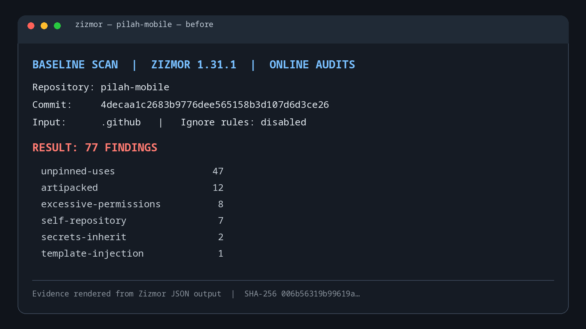
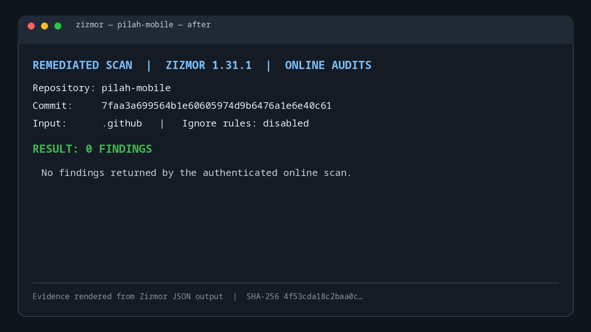

# Zizmor CI remediation — pilah-mobile

The authenticated online Zizmor scan went from **77 findings** on the `staging` baseline to **0 findings** after remediation. Scans used Zizmor `1.31.1`, included online audits, scanned `.github`, and disabled ignore rules. No findings were suppressed.

- Baseline `origin/staging`: `4decaa1c2683b9776dee565158b3d107d6d3ce26`
- Remediation commit: `7faa3a699564b1e60605974d9b6476a1e6e40c61`
- Scan date: 2026-11-02

## Before



| Audit | Findings |
| --- | ---: |
| `artipacked` | 12 |
| `excessive-permissions` | 8 |
| `secrets-inherit` | 2 |
| `self-repository` | 7 |
| `template-injection` | 1 |
| `unpinned-uses` | 47 |
| **Total** | **77** |

## After



**Result: 0 findings.** The scanner JSON output contained no findings.

## Remediation

- Pinned external GitHub Actions to verified full commit SHAs.
- Scoped workflow permissions and disabled checkout credential persistence.
- Passed matrix values through quoted environment variables.
- Replaced inherited reusable-workflow secrets with an explicit secret interface.
- Used GitHub’s $/ syntax for local action and reusable-workflow references.
- Added a blocking online Zizmor scan; no findings were suppressed.

## Evidence

The PNGs are report screenshots rendered from raw JSON outputs of authenticated Zizmor scans. Each image includes the scanned commit, scan mode, finding total, and a shortened SHA-256 digest of its source JSON. Reproduce the scan from the repository root with:

```sh
GH_TOKEN="$(gh auth token)" uvx --from 'zizmor==1.31.1' zizmor --format json --no-ignores --quiet --no-progress .github
```
